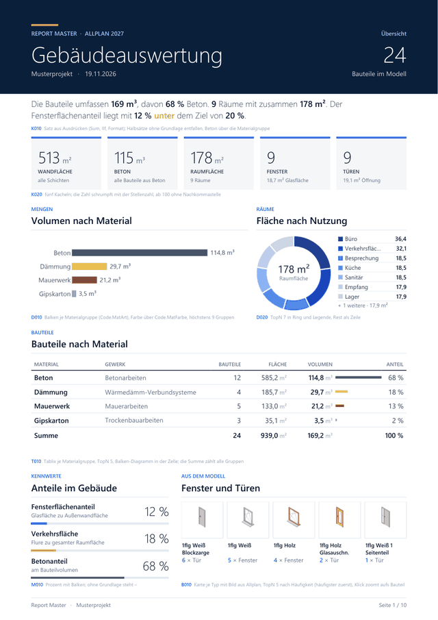
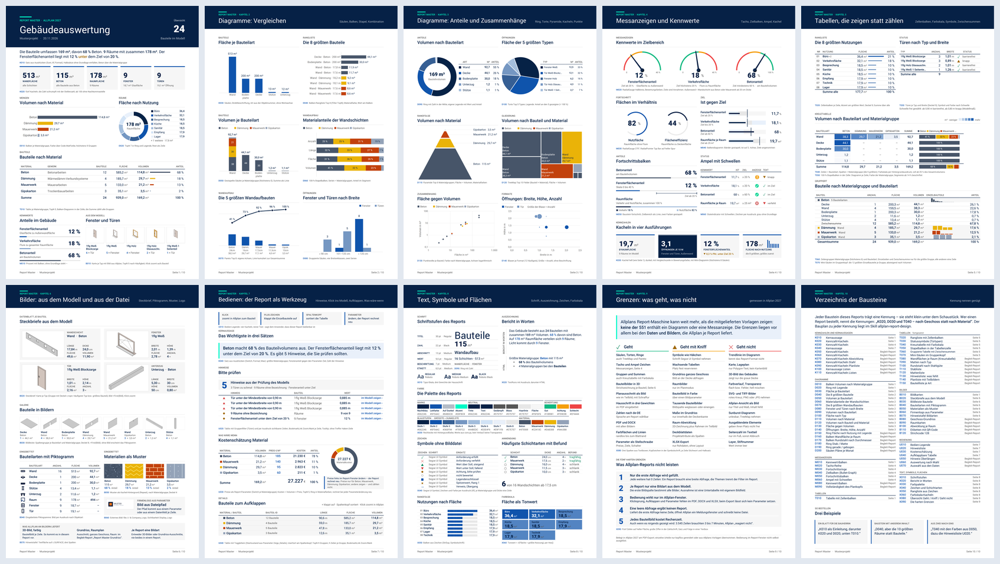
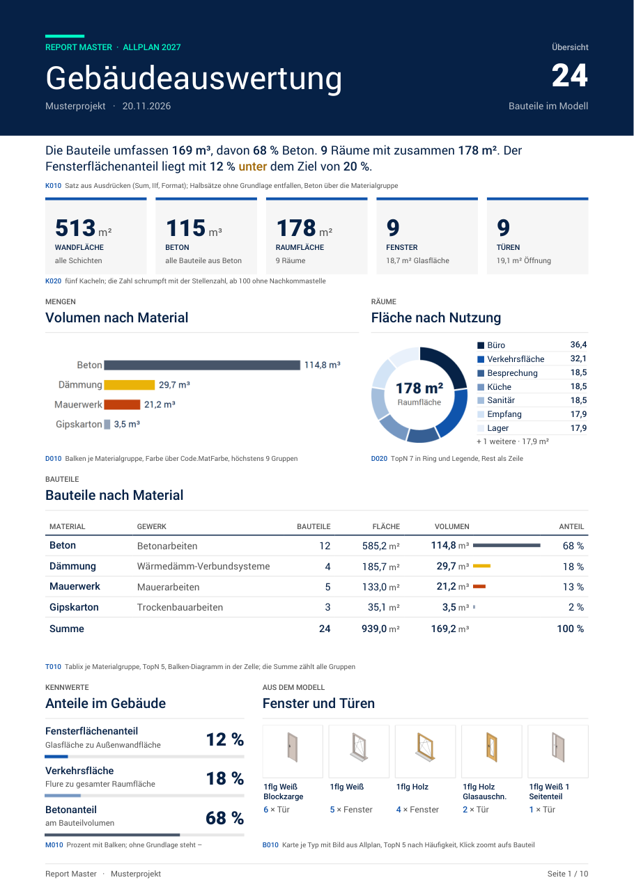
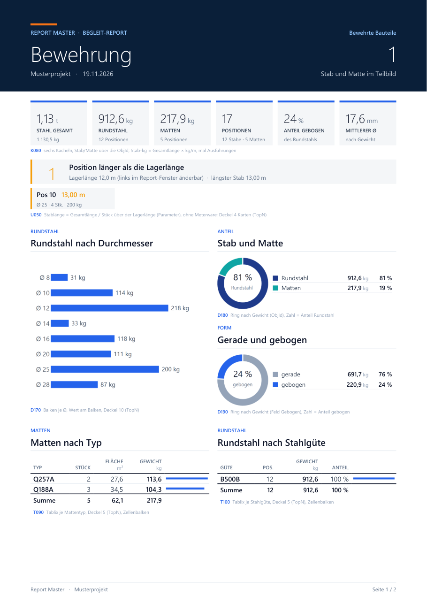
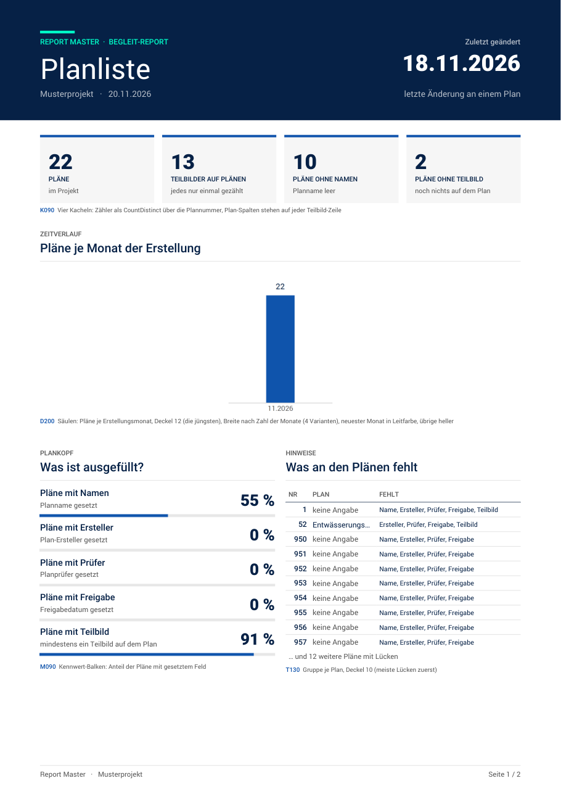
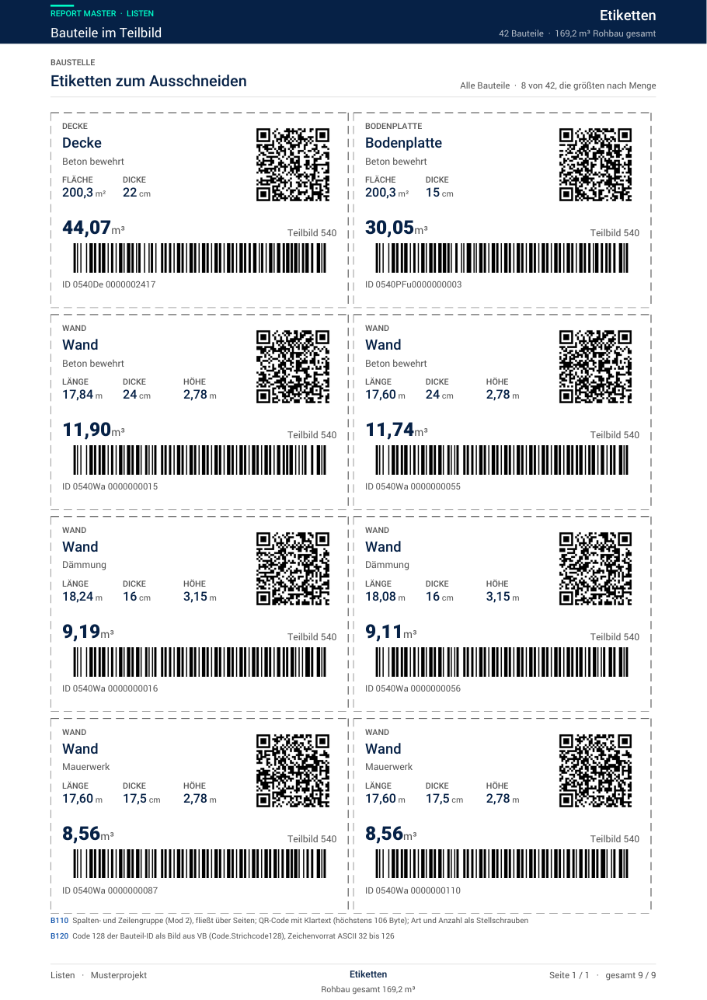
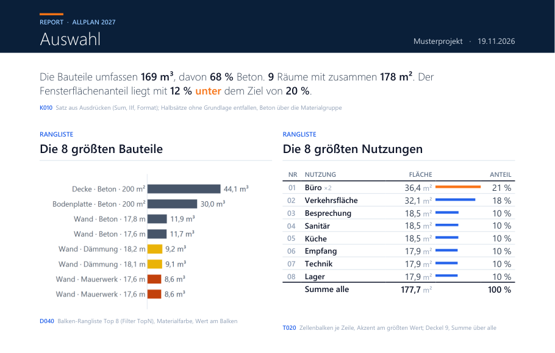
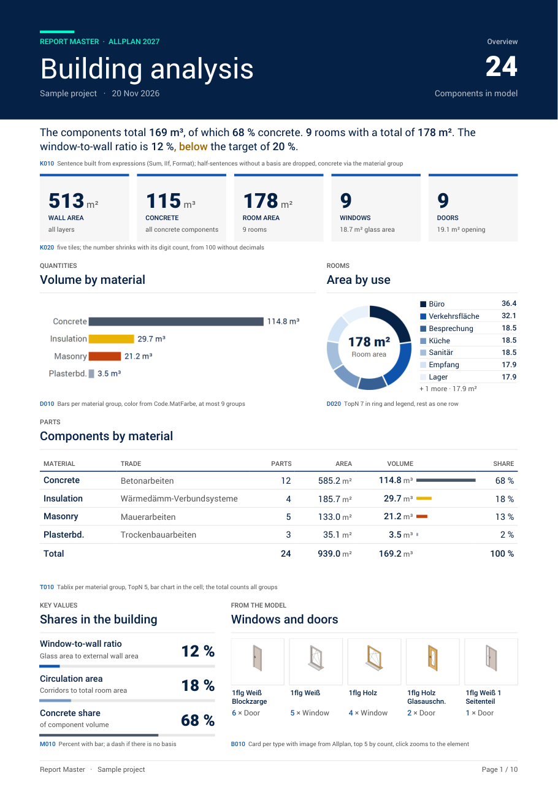
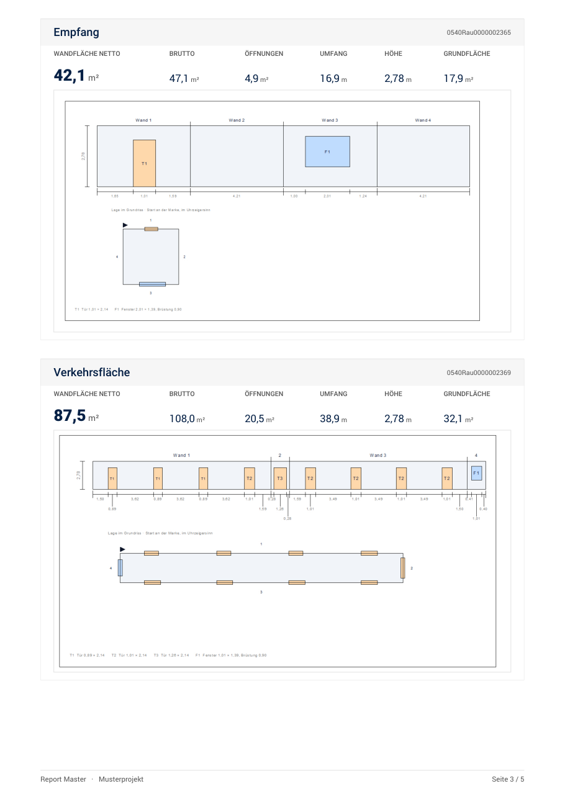

# Allplan Report Design

*[Deutsch](README.md) · English*

**A guide that lets your AI design Allplan reports with charts, key figures and part images – plus ready-made templates you can use without any AI.**

<p align="center">


<a href="https://www.linkedin.com/in/willi-liffers-71660b319/"></a>
</p>

<p align="center"></p>

## What this is

Allplan shows reports with a built-in viewer, the Microsoft ReportViewer. Besides lists, it can also display charts, gauges and images. That makes it possible to add designed evaluations of your own to the 551 templates that ship with Allplan.

This repo contains a **skill**. That is a guide with tools that your AI reads before it starts working. With it, the AI writes report templates (`.rdlc`) with charts, gauges, key-figure tiles, tables and part images from your model. What of this really works in Allplan 2027 was measured and is written down in the skill.

There are also seven finished templates per language: a **master report** with 10 pages and six companion reports, 81 building blocks in all (50 in the master, 31 in the companion reports). You can use them in Allplan right away or take them as a model for your own reports. The controls in the Allplan report window (sliders, expanding, sorting) were also tried out first-hand; what is not secured there is listed in [Checked and not checked](#checked-and-not-checked).

<p align="center"></p>

## What the master contains

The master has 10 pages and 50 **building blocks**. A building block is a finished section of the report, for example a chart, a key-figure tile or a table. Every block has a fixed **identifier** such as `D040` (see [Ordering by identifier](#ordering-by-identifier)).

| Page | Topic | Identifiers |
|---|---|---|
| 1 | Overview: key statement, key figures, bars, ring, table, image cards | K010, K020, M010, D010, D020, T010, B010 |
| 2 | Comparing: columns, rankings, stacked bars, Pareto | D030 to D080 |
| 3 | Shares: ring, pie, pyramid, treemap, scatter, bubbles | D090 to D140 |
| 4 | Gauges: key-figure tiles, dials, rings, target bars, traffic light | K030, M020 to M060 |
| 5 | Tables with graphics in the cells, subtotals | T020 to T070 |
| 6 | Images from the model: profiles, image strip, pictograms, patterns | B020 to B070 |
| 7 | Interaction: notice list, cost estimate, expandable table | K040, U010 to U040 |
| 8 | Text, symbols and colors | X010 to X060 |
| 9 | What works in Allplan reports, what works with a trick and what does not | X080, X090 |
| 10 | Index of all identifiers | – |

Six **companion reports** with 31 building blocks come with it. They are separate because Allplan fills only one query per report and delivers only one kind of image (see [Limits](#limits)).

| Companion report | Content | Identifiers |
|---|---|---|
| Floor plan (2 pages) | Storey floor plan and room cards | K050, D150, M080, B080, B090 |
| Room elevations | Sheet 1 with tiles and one room card, each further sheet with two rooms | K070, B100 |
| Wall finishes (1 page) | Plaster, paint and reveals per room, from the room finishes | K060, D160, T080 |
| Reinforcement | Steel quantities, overlengths, bar list and mesh list | K080, U050, D170 to D190, T090 to T120 |
| Layout list | Plans per month, completeness of the title block, what is missing, plan list | K090, D200, M090, T130, T140 |
| Lists | Part lists over many pages, labels with QR code to cut out, evaluation of your choice | K100, K110, U060, U070, T150, B110, B120 |

<p align="center"></p>

**Reinforcement.** The report shows the steel quantities of your drawing file: total steel, rebar by diameter, meshes, share bent. It points out overlengths (you set the "stock length" control yourself) and delivers the complete bar list with a bending-shape image and the complete mesh list. It calculates the weight as length × weight per meter and thereby matches Allplan's own lists.

<p align="center"></p>

**Layout list.** The report evaluates the plans of your project, not the parts. You see what is missing on the plans: plans per month, completeness of the title block and the "what is missing" list. On top comes the complete plan list with the drawing files per plan.

<p align="center"></p>

**Lists.** A report that flows over many pages: complete part lists per kind, each kind on its own page with its own page numbering, the group name in the footer and a PDF bookmark. At the end comes a sheet of labels to cut out: 8 labels per page with kind, name, material, dimensions and quantity. The QR code on the label contains these details as text, which a phone shows when scanning; the barcode is for handheld scanners. You set the kind of part and the number of labels yourself (always the largest by quantity). You set the evaluation yourself: group, sorting and number of rows are controls.

<p align="center"></p>

Finished examples as PDF are in [beispiel/deu](beispiel/deu) (German) and [beispiel/eng](beispiel/eng): master, floor plan, room elevations, selection by identifier, reinforcement and lists. They were output from Allplan 2027, on a test building or sample model of our own (for the master, floor plan, room elevations and the selection: 24 parts, 9 rooms). For publication, the project name was set to "Sample project", and the company logo on page 6 is a placeholder. For the layout list and the wall finishes there is one PDF each from the preview: **preview with sample data, not from Allplan.** Both reports were output from Allplan on real projects and looked at. In addition there is `Overview_Master.pdf` with all ten master pages on one sheet.

## What you need

- **Allplan 2027** to open the finished reports. For the preview on your computer, the skill also needs Allplan 2027 (it uses its program files to render).
- **Python 3.10 or newer.** For building and checking, the Python of Allplan 2027 is enough: `C:\Program Files\Allplan\Allplan 2027\Prg\Python\python.exe`.
- **An AI that may read files and run commands:** GitHub Copilot in VS Code (agent mode – the mode in which Copilot changes files and runs commands itself), Claude Code or Codex.
- Only for two side tools, a **Python of your own, 3.10 or newer**: saving PDF pages as images (`python -m pip install pymupdf pillow`) and the included tests (`python -m pip install pytest`). The Python of Allplan lacks PyMuPDF and pytest; Pillow is already there. Building, preview, the English version and checking do not need them.
- **Note on the preview:** For it, the AI builds a small helper program once and starts a PowerShell script with the switch `-ExecutionPolicy Bypass` to do so. The AI asks first. This is expected and affects only this one script.

## Setup

The skill consists of folders that you copy into your project folder. That is the folder you open in VS Code or in the terminal. Each tool looks for skills in its own place. Copy the **contents** of the `skills\` folder of this repo there. Afterwards two skill folders are in place: `allplan-report-design` (designing) and `allplan-report` (basics: queries, attributes, checking).

Keep the path of your project folder short, for example `C:\Projects\Reports`. A detailed guide is in [docs/guide-en.md](docs/guide-en.md).

### GitHub Copilot in VS Code

```
your-project\
└── .github\
    └── skills\
        ├── allplan-report-design\
        └── allplan-report\
```

Open the project folder in VS Code, switch to **agent mode** in the Copilot chat and describe what you want.

### Claude Code

```
your-project\
└── .claude\
    └── skills\
        ├── allplan-report-design\
        └── allplan-report\
```

Start Claude Code in the project folder. The skill is picked up by itself when a task fits.

### Codex

Codex is the coding tool from OpenAI (ChatGPT).

```
your-project\
└── .agents\
    └── skills\
        ├── allplan-report-design\
        └── allplan-report\
```

Start Codex in the project folder and describe the report.

### ChatGPT in the chat window

The plain chat window cannot read files in your folder and cannot run commands. The skill is meant for an AI that can. In the chat window you can upload `SKILL.md` and the `references\` folder as knowledge and have it write build scripts that you run yourself. **This has not been tried.**

### Create the workshop

After copying, you create the **workshop**. That is a working folder of its own with the construction kit for the reports. The AI works there, and your finished reports end up in its subfolder `out`. You can tell the AI to do it (see below) or run it yourself, here for Copilot:

```powershell
python .github\skills\allplan-report-design\werkstatt_anlegen.py reports
```

With Claude Code the skill folder is `.claude\skills\allplan-report-design`, with Codex `.agents\skills\allplan-report-design`. The target folder must be empty or must not exist yet.

`master\core.py` contains `VERFASSER = "W. Liffers"` (the author name). Change it to your own name before your first report of your own (or tell the AI). Otherwise every generated file carries that name.

> **Not tried:** The folders are the ones where these tools expect skills. Setting up with this skill has not yet been tried on someone else's computer.

## How to use the skill

This is the core. You describe in plain sentences what you want. The AI reads the skill, works in the workshop and hands back files and images. You do not have to understand the report file.

**Step 1: Create the workshop and look at the master**

> "Create the workshop in the folder reports and show me the master."

The AI runs `werkstatt_anlegen.py`, builds the master with sample data and shows you preview images of the 10 pages. You get the file `out\Report_Master.rdlc` and the images. For the preview it builds a small viewer program once, from the program files of Allplan 2027.

**Step 2: Order a report of your own**

> "Build me a one-page report with K010, D040 and T020, titled 'Shell construction overview', without identifier lines."

The AI stacks the three blocks into one report with a single command. You get a file in `out\` and a preview image. The section [Ordering by identifier](#ordering-by-identifier) explains the identifiers.

**Step 3: Want a block to be different**

> "I need D040, but with the ten largest rooms instead of parts."

The AI copies the block and changes it. If the report lacks data for that, it extends the query. It may then ask you to output a small probe report from Allplan as an Excel file, from which it makes sample data. You get the changed file in `out\` and a new preview image.

**Step 4: The English version**

> "Turn it into the English version."

For a report of your own, the AI first enters the new texts into the translation table and fills them in English (the commands are under [For developers](#for-developers)). Then it creates the English file in `out\eng\` and looks at the English image, because English texts have a different length. You get the English file and a preview image.

**Step 5: Have it checked**

> "Check the report and tell me what I should look at in Allplan."

The AI checks the file with the check script of the skill `allplan-report`. You get the check line word for word, for example `AMPEL: GRUEN | validate_rdlc | 1 Dateien, 0 Fehler, 0 Warnungen`. GRUEN (green) means no findings. ORANGE means notes only, which the AI explains to you. ROT (red) means errors, which it fixes before it hands you the file. Two templates report one note each (ORANGE) on purpose: wall finishes "table wider than body", because only one of three column widths is ever visible, and room elevations "RepeatOnNewPage missing", because the first row is a heading and not a column header. You also get a list of what to look at in Allplan: is the number of rows right? Are the totals right? Do images and umlauts show correctly?

The check on the computer does not replace a look in Allplan. Until you report back what you saw there, the report counts as **not checked in Allplan**.

**Then open it in Allplan:** Copy the file from `out\` into the office folder of Allplan (see [Using finished templates without an AI](#using-finished-templates-without-an-ai)), open the report and look at it against the model. If something differs, tell the AI exactly that, for example "Two columns are missing on the 1st floor".

**For reinforcement, layout list and lists too:** You do not have to start with identifiers. Tell the AI in everyday words what you need:

> "Build me a reinforcement overview for this drawing file."
>
> "I need a part list per kind, each kind on its own page, with a QR code."
>
> "Show me what is still missing on my plans."

For a new wish, the AI first looks in its list "wish → way". It holds 60 wishes with the verdict "works", "works with a trick" or "does not work" and the way to get there. If something does not work, it tells you honestly.

**Good to know:** In large projects, the output in Allplan takes minutes. In the report window, the master needs 22 to 24 seconds until the first page, further pages 5 to 15 seconds.

## Ordering by identifier

Every one of the 81 building blocks has a fixed identifier: one letter for the kind and three digits.

| Letter | Kind |
|---|---|
| K | Key figure, key statement |
| D | Chart |
| M | Gauge |
| T | Table |
| B | Image |
| U | Interaction |
| X | Text, symbol, area |

The identifier is printed small below the block in the report and collected on page 10 of the master. When you name identifiers, that is the order: the AI takes exactly these blocks and changes only what you tell it.

Example: **K010, D040, T020** gives a key statement in one sentence, a bar chart of the eight largest parts and a ranking with bars in the cells.

<p align="center"></p>

Name the identifiers in the order you want. Narrow blocks stand side by side, and a page break comes by itself. With "without identifier lines" the small identifiers below the blocks are left out; that is the version for customers.

**This applies to the 50 master blocks.** The 31 blocks of the companion reports have a query of their own. They cannot be stacked with others but are built together with their report. If you name such an identifier when stacking, `build_auswahl.py` tells you so by name.

## Using finished templates without an AI

The finished reports are in [vorlagen/deu](vorlagen/deu) (German) and [vorlagen/eng](vorlagen/eng) (English). You do not need an AI for this.

1. Copy the files of one language folder into a folder of your own among the office reports of Allplan 2027, for example `C:\allplandaten\2027\Std\Reports\eng\My reports\` (German: `...\Reports\deu\My reports\`). This is the default path. Where your data lives is shown in the path settings in Allplan.
2. In Allplan, open the report dialog and choose the template in your category.

The seven templates per language and what each needs (Teilbild – the name Allplan uses for a drawing file of the project):

| German | English | Needs |
|---|---|---|
| Report Master | Report Master | a drawing file with the parts |
| Report Master Grundriss | Report Master Floor plan | a drawing file with parts and rooms |
| Report Master Raum-Abwicklung | Report Master Room elevations | rooms **and** a drawing file with the elevation drawings, both together (see [Room elevations](#room-elevations)) |
| Report Master Wandbeläge | Report Master Wall finishes | rooms with room finishes; rooms without a finish are missing in the report |
| Report Master Bewehrung | Report Master Reinforcement | a drawing file with reinforcement |
| Report Master Planliste | Report Master Layout list | a project with plans (no drawing file) |
| Report Master Listen | Report Master Lists | a drawing file with the parts |

Example PDFs are in [beispiel/deu](beispiel/deu) and [beispiel/eng](beispiel/eng). The PDFs for the layout list and the wall finishes are **preview with sample data, not from Allplan**; in Allplan, both were output on real projects and looked at. `beispiel/eng` also holds `Overview_Master.pdf` (in `beispiel/deu`: `Uebersicht_Master.pdf`) with all ten master pages on one sheet.

More is in [vorlagen/README.md](vorlagen/README.md).

## German and English

All reports exist in both languages. The English version has its texts in translation tables, including the messages for empty sections. Page bookmarks ("Title – page n") need no entry of their own. The translation tables hold 1186 entries in all (19 files), none open. Numbers and dates follow the en-US format. Names from your model, such as rooms and materials, stay as they are in the project. Material groups are recognized by German and English words, for example concrete, masonry, insulation, timber, steel, glass.

For a report of your own, you enter the new texts into the table with `--sammeln`, the AI fills them in English, `--offen` shows 0, and `--en` creates the file (step 4 above).

<p align="center"></p>

## Room elevations

The room elevations show, per room, one continuous band of all walls with all dimensions and a small location sketch. Sheet 1 carries the tiles and one room card, each further sheet two. The report shows at most 8 rooms; further ones are named in a line "… and n more".

**Important:** The report does not draw anything itself. It shows only what lies in the drawing file. The drawing has to be there beforehand: per room a frame as a thin slab, material "Abwicklung", designation equal to the component ID of the room (the identifier Allplan gives to every component). Without such a drawing the section stays empty. The report also needs **two drawing files together**: the one with the rooms and the one with the elevation drawings. Without the drawing file with the rooms, the room cards stay empty.

The package contains the calculation core that computes the elevation, and a preview. A tool that places the drawing in Allplan is **not** included. The drawing in the example was created specially. If you want to use the room elevations, you have to bring the drawing into the drawing file yourself or build a tool of your own for it.

<p align="center"></p>

## Checked and not checked

| What | Status |
|---|---|
| **Controls in the Allplan report window** | **Operated and checked first-hand in the window:** controls (checkbox, number, list) take effect at once; expanding; sorting by click; jump into a second report with a way back; outline bar; fixed table header (visible at 200 % zoom); subreport. The master needs 22 to 24 seconds in the window until the first page, further pages 5 to 15 seconds. |
| **Click into the model** (zoom to the part) | **Not secured.** It is built in, but in the window that was opened for testing it had no effect. Whether it works when the report is opened through Allplan's "Reports" command is **not checked**. Do not rely on it. |
| Master, floor plan, room elevations and selection by identifier, German and English | Output as PDF from Allplan 2027 and looked at, on a test building of our own (24 parts, 9 rooms). For publication, the project name was set to "Sample project", and the company logo on page 6 is a placeholder. |
| Reinforcement, German and English | Output as PDF from Allplan 2027 and looked at: on a sample model of our own (12 bar and 5 mesh positions) and on a project with real reinforcement. There the totals equal those in Allplan's own reinforcement overview. |
| Layout list, German and English | Output as PDF from Allplan 2027 and looked at, on a project with 22 plans. The example PDF in the repo is a preview with sample data, not from Allplan. |
| Lists, German and English | Output as PDF from Allplan 2027 and looked at, on a test building of our own and on a residential house (11 pages). All QR codes and barcodes were read back from the Allplan PDF. |
| Wall finishes, German and English | Output as PDF from Allplan 2027 and looked at, on a residential house. The example PDF in the repo is a preview with sample data, not from Allplan. |
| Window against PDF, compared page by page | Master in German all 10 pages, in English pages 1, 3 and 7; room elevations 5 pages (English page 1); floor plan 2 pages; layout list pages 1 and 2; selection; reinforcement 2 pages in German and English; lists 9 pages. Result: **it sits as in the PDF.** The sentences of the key statements break at a different place, and embedded pictograms are drawn finer in the window. In the lists report, all six controls take effect in the window, including the multiple-choice list of materials and the two for the label sheet (kind of part, number). |
| Master on a real project (residential house, 121 parts, 29 rooms, 20 drawing files) | Freshly output from Allplan 2027: 10 pages, German and English, about 40 seconds each. On the same project: lists 11 pages, wall finishes 1 page. A bug was found and fixed on the way: when the same room use stood in the model in two spellings ("Flur" and "FLUR"), a legend showed the line "+ n more" twice and the report had 11 pages. |
| The commands of the skill on the computer: create the workshop, build (also reinforcement, layout list and lists), preview with its switches, English version, compute the room elevation, check | All run through, with the Python of Allplan 2027 and with a separate Python 3.10, from a copy fetched with git and from the ZIP, in a folder with spaces and umlauts. **On one single computer** (Windows 11, Allplan 2027 in its default location). |
| Tooltips, clicking hyperlinks, export from the report window | **Not checked.** |
| Not re-checked in the report window: wall finishes; of the English master pages 2, 4 to 6 and 8 to 10; the respective other state of the either-or places (page 6 without model image, page 7 without notices, layout list with 2 to 6 months) | **Not checked.** |
| A real English-language project | **Not checked.** English material names were checked only with re-created data. |
| Room elevations for L-shaped rooms and slanted walls | Only calculated and tested automatically, **not in the model** |
| Reinforcement with "executions" greater than 1 | **Not checked on real data.** The rule comes from Allplan's templates. |
| Setup in Copilot, Codex and Claude Code with this skill | **Not tried on someone else's computer.** The folders are the ones where these tools expect skills. |
| ChatGPT in the chat window without file access | **Not tried** |

## Limits

- Allplan fills only the first query of a report. A report therefore has one wide query from which all parts take their data.
- A report has only one kind of image from the model: either 3D part images or plan sections (floor plan). If you need both, you get two reports.
- A subreport does not lift these two limits: Allplan gives it the rows of the main report.
- Interaction such as expanding, sorting and controls exists only in the Allplan window, not in the PDF. The click into the model is built in, had no effect in the test window and is not checked through Allplan's "Reports" command (see the table above).
- Parameters accept only fixed defaults and fixed lists. Expressions as defaults, dependent lists and lists from a second query do not work. A selection list from the data works through a trick of its own.
- Hidden parameters stay visible in the report window.
- On the way through reports, Allplan does not deliver a reliable list of all drawing files. Plans and project data can be evaluated as PDF and Word, not as Excel.
- Elements in a report must not overlap. Otherwise the Allplan report window pushes one of them away: text is cut off, blocks slip. PDF and preview do not show this. The check script reports it.
- If the query returns no row, no report is created.
- Dimension chains outside the slab edge are missing in the floor plan image.
- The room elevations do not draw by themselves (see above).
- With every report output, Allplan does not return some of its memory and crashes after a few hundred outputs in one session. Irrelevant in daily work; for series, restart Allplan.
- With thousands of parts, the output takes minutes. The master needs 22 to 24 seconds in the window until the first page.

## Feedback

Report bugs and wishes through the [Issues](../../issues) of this repo. Please write which tool you use, what you asked the AI to do and what happened instead. Please do not attach project data that must not be public.

## For developers

```
README.md, README.en.md          Description (German, English)
docs\                            Guide (anleitung-de.md, guide-en.md) and images
skills\
    allplan-report-design\       Skill: design reports, with construction kit and master
    allplan-report\              Base skill: queries, attributes, checking
vorlagen\deu, vorlagen\eng       Finished templates (.rdlc)
beispiel\deu, beispiel\eng       Examples as PDF
CHANGELOG.md, HAFTUNGSAUSSCHLUSS.md, THIRD_PARTY_NOTICES.md
```

The most important commands:

```powershell
# Create the workshop (folder must be empty or missing)
python skills\allplan-report-design\werkstatt_anlegen.py <folder>

# In the workshop: build the master and render it headless
python master\build_master.py --render

# In the workshop: report from identifiers
python master\build_auswahl.py --bausteine=K010,D040,T020 --titel="Shell construction overview" --name=Shell --ohne-etikett --render

# In the workshop: build the companion reports reinforcement, layout list and lists and render them headless
python master\bewehrung\build_bewehrung.py --render
python master\projektlisten\build_planliste.py --render
python master\listen\build_listen.py --render

# In the workshop: English version of a report of your own (collect texts, show open ones, create)
# --sammeln writes new texts to master\sprache\en\eigene.json (value null), --offen must show 0,
# --en writes the file to out\eng\ (without a file name: all reports in out\ whose name does not start with _)
python master\sprache.py --sammeln out\<file>.rdlc
python master\sprache.py --offen out\<file>.rdlc
python master\sprache.py --en out\<file>.rdlc

# In the workshop: tests, 100 of them (need a Python of your own with pytest, not the one of Allplan).
# Without the built preview program the run shows "99 passed, 1 skipped".
python -m pytest werkzeug\tests -q

# Check reports, look up attributes (adjust the path to the base skill)
python skills\allplan-report\scripts\validate_rdlc.py <file or folder>
python skills\allplan-report\scripts\lookup_attribute.py 220 --suche Höhe
```

The check script has 44 rules (16 errors E01 to E16, 28 warnings W01 to W28). 19 of them come from measurements in Allplan: 8 errors (E09 to E16) and 11 warnings (W18 to W28). W28 reports overlapping elements. Allplan's own 551 templates pass with no new error. Two more window rules are in the skill without the check script knowing them; the AI learns from them: a hidden field that lies loose next to other elements can push them around in the window and belongs in a container of its own across the full width. Small type (up to 8.5 pt) is set 3 to 8 % wider in the window than in the PDF, so 10 % width reserve applies.

Switches of the preview program: `--pdf` and `--format=xlsx|docx` (PDF, Excel and Word output), `--info` (show the parameter list), `Name=Value1|Value2` (several values per parameter), `--vollzugriff` (report code with full rights, as in Allplan; set it only if the report has to read files). Numbers for controls take a dot or a comma (`0.8` and `0,8`). It treats subreports like Allplan.

The base skill reads the template library and the attribute catalog from the Allplan installation (`C:\ProgramData\Nemetschek\Allplan\2027\Etc\Reports` and `...\Etc\Xml`). The Allplan templates themselves are not in this repo. How far checking and lookup work on a computer without Allplan 2027 has not been tried.

## Liability and license

This is a private project and is provided without warranty. Check every result against the model. The details are in [HAFTUNGSAUSSCHLUSS.md](HAFTUNGSAUSSCHLUSS.md) (German with an English section). Third-party components and trademarks are named in [THIRD_PARTY_NOTICES.md](THIRD_PARTY_NOTICES.md).

Allplan is a trademark of its owner. This project is not a product of the maker of Allplan.

License: MIT, see [LICENSE](LICENSE). Copyright (c) 2026 W. Liffers. The software is provided without warranty (see [HAFTUNGSAUSSCHLUSS.md](HAFTUNGSAUSSCHLUSS.md)).
