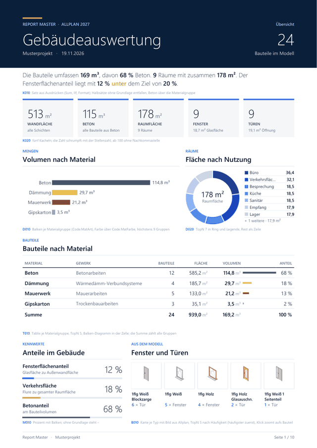
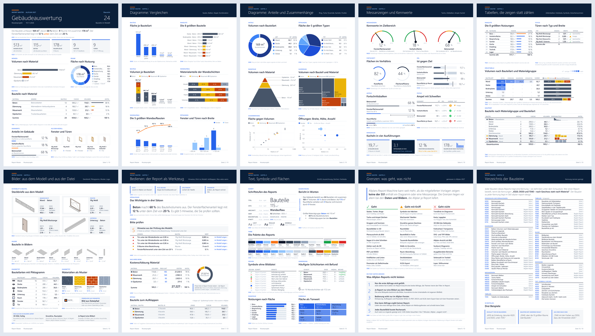
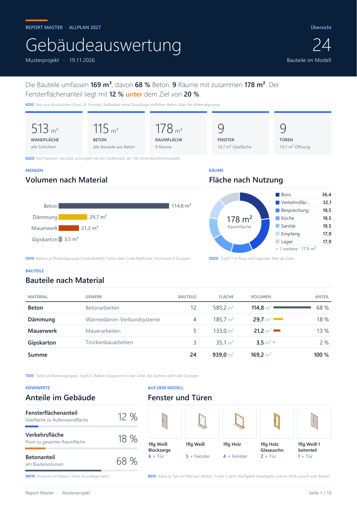
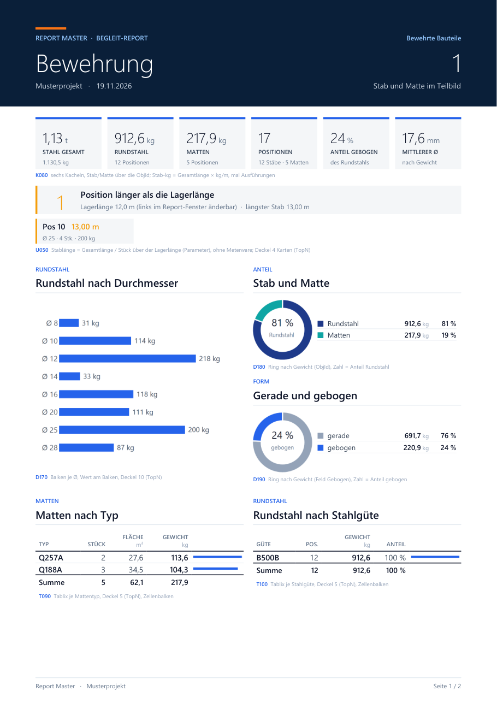
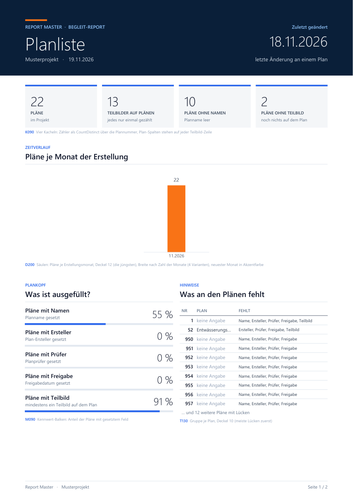
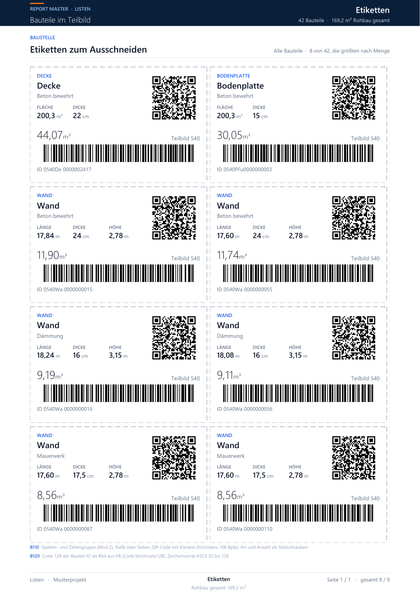
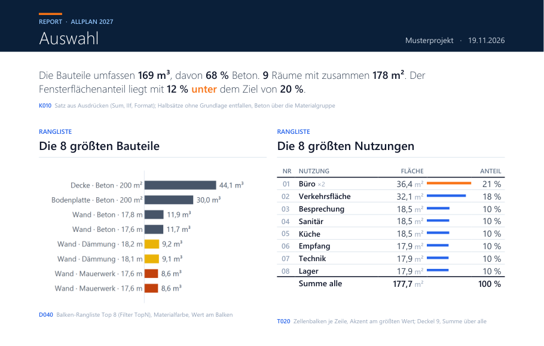
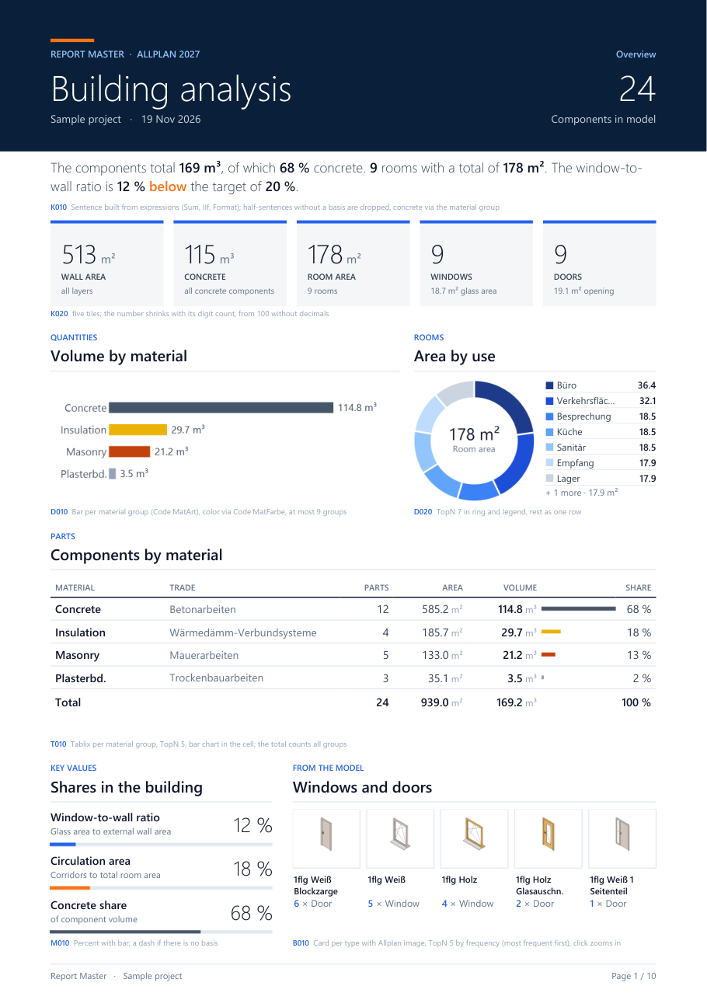
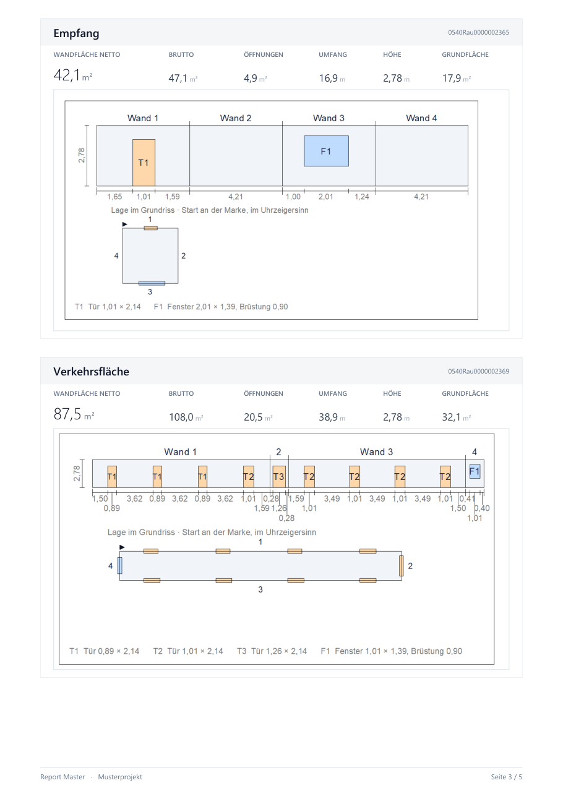

# Allplan Report Design

*Deutsch · [English](README.en.md)*

**Eine Anleitung für deine KI, Allplan-Reports mit Diagrammen, Kennzahlen und Bauteilbildern zu gestalten – und fertige Vorlagen, die du ohne KI benutzen kannst.**

<p align="center">


<a href="https://www.linkedin.com/in/willi-liffers-71660b319/"></a>
</p>

<p align="center"></p>

## Was das ist

Allplan zeigt Reports mit einer eingebauten Anzeige, dem Microsoft ReportViewer. Die kann viel mehr, als die 551 Vorlagen nutzen, die Allplan mitliefert: In keiner davon steckt ein Diagramm.

Dieses Repo enthält einen **Skill**. Das ist eine Anleitung mit Werkzeugen, die deine KI liest, bevor sie arbeitet. Damit schreibt sie dir Reportvorlagen (`.rdlc`) mit Diagrammen, Messanzeigen, Kennzahl-Kacheln, Tabellen und Bauteilbildern aus deinem Modell. Was davon in Allplan 2027 wirklich läuft, wurde gemessen und steht im Skill.

Dazu gibt es sieben fertige Vorlagen je Sprache: einen **Master-Report** mit 10 Seiten und sechs Begleit-Reports, zusammen 81 Bausteine (50 im Master, 31 in den Begleit-Reports). Du kannst sie direkt in Allplan benutzen oder als Vorbild für eigene Reports nehmen. Auch die Bedienung im Report-Fenster von Allplan (Stellschrauben, Aufklappen, Sortieren) wurde selbst ausprobiert; was dabei nicht gesichert ist, steht in [Geprüft und nicht geprüft](#geprüft-und-nicht-geprüft).

<p align="center"></p>

## Was im Master steckt

Der Master hat 10 Seiten und 50 **Bausteine**. Ein Baustein ist ein fertiger Abschnitt des Reports, zum Beispiel ein Diagramm, eine Kennzahl-Kachel oder eine Tabelle. Jeder Baustein hat eine feste **Kennung** wie `D040` (siehe [Bestellen per Kennung](#bestellen-per-kennung)).

| Seite | Thema | Kennungen |
|---|---|---|
| 1 | Übersicht: Kernaussage, Kennzahlen, Balken, Ring, Tabelle, Bildkarten | K010, K020, M010, D010, D020, T010, B010 |
| 2 | Vergleichen: Säulen, Ranglisten, gestapelte Balken, Pareto | D030 bis D080 |
| 3 | Anteile: Ring, Torte, Pyramide, TreeMap, Punktwolke, Blasen | D090 bis D140 |
| 4 | Messanzeigen: Kennzahl-Kacheln, Tachos, Ringe, Zielbalken, Ampel | K030, M020 bis M060 |
| 5 | Tabellen mit Grafik in den Zellen, Zwischensummen | T020 bis T070 |
| 6 | Bilder aus dem Modell: Steckbriefe, Bildleiste, Piktogramme, Muster | B020 bis B070 |
| 7 | Bedienen: Hinweisliste, Kostenschätzung, aufklappbare Tabelle | K040, U010 bis U040 |
| 8 | Text, Zeichen und Farben | X010 bis X060 |
| 9 | Was in Allplan-Reports geht, geht mit Kniff und geht nicht | X080, X090 |
| 10 | Verzeichnis aller Kennungen | – |

Dazu kommen sechs **Begleit-Reports** mit 31 Bausteinen. Sie sind getrennt, weil Allplan je Report nur eine Abfrage füllt und nur eine Bildart liefert (siehe [Grenzen](#grenzen)).

| Begleit-Report | Inhalt | Kennungen |
|---|---|---|
| Grundriss (2 Seiten) | Geschossgrundriss und Raumkarten | K050, D150, M080, B080, B090 |
| Raum-Abwicklung | Blatt 1 mit Kacheln und einer Raumkarte, jedes weitere Blatt mit zwei Räumen | K070, B100 |
| Wandbeläge (1 Seite) | Putz, Anstrich und Leibung je Raum aus dem Raumausbau | K060, D160, T080 |
| Bewehrung | Stahlmengen, Überlängen, Stab- und Mattenliste | K080, U050, D170 bis D190, T090 bis T120 |
| Planliste | Pläne je Monat, Vollständigkeit des Plankopfs, was fehlt, Planliste | K090, D200, M090, T130, T140 |
| Listen | Bauteillisten über viele Seiten, Etiketten mit QR-Code zum Ausschneiden, Auswertung nach Wahl | K100, K110, U060, U070, T150, B110, B120 |

<p align="center"></p>

**Bewehrung.** Der Report zeigt dir die Stahlmengen deines Teilbilds: Stahl gesamt, Rundstahl nach Durchmesser, Matten, Anteil gebogen. Er weist auf Überlängen hin (die Stellschraube „Lagerlänge“ stellst du selbst ein) und liefert die vollständige Stabliste mit Biegeform-Bild und die vollständige Mattenliste. Das Gewicht rechnet er aus Länge × Metergewicht und trifft damit Allplans eigene Listen.

<p align="center"></p>

**Planliste.** Der Report wertet die Pläne deines Projekts aus, nicht die Bauteile. Du siehst, was an den Plänen fehlt: Pläne je Monat, Vollständigkeit des Plankopfs und die Liste „was fehlt“. Dazu kommt die vollständige Planliste mit den Teilbildern je Plan.

<p align="center"></p>

**Listen.** Ein Report, der über viele Seiten fließt: vollständige Bauteillisten je Art, jede Art auf eigener Seite mit eigener Seitenzählung, dem Gruppennamen im Fuß und einem PDF-Lesezeichen. Am Ende steht ein Etikettenblatt zum Ausschneiden: 8 Etiketten je Seite mit Art, Name, Material, Maßen und Menge. Der QR-Code auf dem Etikett enthält diese Angaben als Text, den ein Telefon beim Scannen anzeigt; der Strichcode ist für Handscanner. Bauteilart und Anzahl der Etiketten stellst du selbst ein (es sind immer die größten nach Menge). Die Auswertung stellst du selbst ein: Gruppe, Sortierung und Zeilenzahl sind Stellschrauben.

<p align="center"></p>

Fertig ausgegebene Beispiele als PDF liegen in [beispiel/deu](beispiel/deu) und [beispiel/eng](beispiel/eng): Master, Grundriss, Raum-Abwicklung, Auswahl per Kennung, Bewehrung und Listen. Sie sind aus Allplan 2027 ausgegeben, an einem eigenen Testgebäude bzw. Probemodell (beim Master, Grundriss, Raum-Abwicklung und der Auswahl: 24 Bauteile, 9 Räume). Der Projektname wurde für die Veröffentlichung auf „Musterprojekt“ gesetzt, das Firmenlogo auf Seite 6 ist ein Platzhalter. Für Planliste und Wandbeläge liegt je ein PDF aus der Vorschau: **Vorschau mit Beispieldaten, nicht aus Allplan.** Beide Reports wurden in Allplan an echten Projekten ausgegeben und angesehen. Dazu kommt `Uebersicht_Master.pdf` mit allen zehn Master-Seiten auf einem Blatt.

## Was du brauchst

- **Allplan 2027** zum Öffnen der fertigen Reports. Für die Vorschau am Rechner braucht der Skill ebenfalls Allplan 2027 (er nutzt dessen Programmdateien zum Anzeigen).
- **Python 3.10 oder neuer.** Für Bauen und Prüfen genügt das Python von Allplan 2027: `C:\Program Files\Allplan\Allplan 2027\Prg\Python\python.exe`.
- **Eine KI, die Dateien lesen und Befehle ausführen darf:** GitHub Copilot in VS Code (Agent-Modus – die Betriebsart, in der Copilot selbst Dateien ändert und Befehle ausführt), Claude Code oder Codex.
- Nur für zwei Nebenwerkzeuge ein **eigenes Python 3.10 oder neuer**: PDF-Seiten als Bilder ablegen (`python -m pip install pymupdf pillow`) und die mitgelieferten Tests (`python -m pip install pytest`). Im Python von Allplan fehlen PyMuPDF und pytest; Pillow ist dort vorhanden. Bauen, Vorschau, englische Fassung und Prüfen brauchen sie nicht.
- **Hinweis zur Vorschau:** Dafür baut die KI einmal ein kleines Hilfsprogramm und startet dazu ein PowerShell-Skript mit dem Schalter `-ExecutionPolicy Bypass`. Die KI fragt vorher nach. Das ist erwartet und betrifft nur dieses eine Skript.

## Einrichten

Der Skill besteht aus Ordnern, die du in deinen Projektordner kopierst. Das ist der Ordner, den du in VS Code oder im Terminal öffnest. Jedes Werkzeug sucht Skills an einer eigenen Stelle. Kopiere den **Inhalt** des Ordners `skills\` aus diesem Repo dorthin. Danach liegen dort zwei Skill-Ordner: `allplan-report-design` (gestalten) und `allplan-report` (Grundlagen: Abfragen, Attribute, Prüfen).

Halte den Pfad deines Projektordners kurz, zum Beispiel `C:\Projekte\Reports`. Eine ausführliche Anleitung steht in [docs/anleitung-de.md](docs/anleitung-de.md).

### GitHub Copilot in VS Code

```
dein-projekt\
└── .github\
    └── skills\
        ├── allplan-report-design\
        └── allplan-report\
```

Öffne den Projektordner in VS Code, wechsle im Copilot-Chat in den **Agent-Modus** und beschreibe, was du willst.

### Claude Code

```
dein-projekt\
└── .claude\
    └── skills\
        ├── allplan-report-design\
        └── allplan-report\
```

Starte Claude Code im Projektordner. Der Skill wird bei passenden Aufträgen von selbst gefunden.

### Codex

Codex ist das Programmier-Werkzeug von OpenAI (ChatGPT).

```
dein-projekt\
└── .agents\
    └── skills\
        ├── allplan-report-design\
        └── allplan-report\
```

Starte Codex im Projektordner und beschreibe den Report.

### ChatGPT im Chatfenster

Das reine Chatfenster kann keine Dateien in deinem Ordner lesen und keine Befehle ausführen. Der Skill ist für eine KI gedacht, die das kann. Im Chatfenster kannst du `SKILL.md` und den Ordner `references\` als Wissen hochladen und dir Bauskripte schreiben lassen, die du selbst ausführst. **Das ist nicht erprobt.**

### Werkstatt anlegen

Nach dem Kopieren legst du die **Werkstatt** an. Das ist ein eigener Arbeitsordner mit dem Bausatz für die Reports. Dort arbeitet die KI, dort landen deine fertigen Reports im Unterordner `out`. Du kannst es der KI sagen (siehe unten) oder selbst ausführen, hier für Copilot:

```powershell
python .github\skills\allplan-report-design\werkstatt_anlegen.py reports
```

Bei Claude Code heißt der Skill-Ordner `.claude\skills\allplan-report-design`, bei Codex `.agents\skills\allplan-report-design`. Der Zielordner muss leer sein oder darf noch nicht existieren.

In `master\core.py` steht `VERFASSER = "W. Liffers"`. Ändere das vor deinem ersten eigenen Report auf deinen Namen (oder sag es der KI). Sonst trägt jede erzeugte Datei diesen Namen.

> **Nicht erprobt:** Die Ordner sind die, an denen diese Werkzeuge Skills erwarten. Mit diesem Skill ist das Einrichten noch nicht an einem fremden Rechner erprobt.

## So setzt du den Skill ein

Das ist der Kern. Du beschreibst der KI in normalen Sätzen, was du willst. Sie liest den Skill, arbeitet in der Werkstatt und gibt dir Dateien und Bilder zurück. Du musst die Report-Datei nicht verstehen.

**Schritt 1: Werkstatt anlegen und den Master ansehen**

> „Lege die Werkstatt im Ordner reports an und zeig mir den Master."

Die KI führt `werkstatt_anlegen.py` aus, baut den Master mit Beispieldaten und zeigt dir Vorschaubilder der 10 Seiten. Du bekommst die Datei `out\Report_Master.rdlc` und die Bilder. Für die Vorschau baut sie einmal ein kleines Anzeigeprogramm aus den Programmdateien von Allplan 2027.

**Schritt 2: Einen eigenen Report bestellen**

> „Baue mir einen einseitigen Report mit K010, D040 und T020, Titel ‚Rohbau-Übersicht', ohne Kennungs-Zeilen."

Die KI stapelt die drei Bausteine mit einem Befehl zu einem Report. Du bekommst eine Datei in `out\` und ein Vorschaubild. Die Kennungen erklärt der Abschnitt [Bestellen per Kennung](#bestellen-per-kennung).

**Schritt 3: Einen Baustein anders haben wollen**

> „Ich brauche D040, aber mit den zehn größten Räumen statt Bauteilen."

Die KI kopiert den Baustein und ändert ihn. Fehlen dem Report dafür Daten, erweitert sie die Abfrage. Dann bittet sie dich vielleicht, in Allplan einen kleinen Probe-Report als Excel-Datei auszugeben, aus dem sie Beispieldaten macht. Du bekommst die geänderte Datei in `out\` und ein neues Vorschaubild.

**Schritt 4: Die englische Fassung**

> „Mach daraus die englische Fassung."

Bei einem eigenen Report trägt die KI zuerst die neuen Texte in die Übersetzungstabelle ein und füllt sie englisch (die Befehle stehen unter [Für Entwickler](#für-entwickler)). Dann erzeugt sie die englische Datei in `out\eng\` und sieht sich das englische Bild an, weil englische Texte anders lang sind. Du bekommst die englische Datei und ein Vorschaubild.

**Schritt 5: Prüfen lassen**

> „Prüfe den Report und sag mir, was ich in Allplan ansehen soll."

Die KI prüft die Datei mit dem Prüfskript des Skills `allplan-report`. Du bekommst die Prüfzeile im Wortlaut, zum Beispiel `AMPEL: GRUEN | validate_rdlc | 1 Dateien, 0 Fehler, 0 Warnungen`. GRUEN heißt: keine Befunde. ORANGE heißt: nur Hinweise, die die KI dir erklärt. ROT heißt: Fehler, die sie behebt, bevor sie dir die Datei gibt. Zwei Vorlagen melden mit Absicht je einen Hinweis (ORANGE): Wandbeläge „Tabelle breiter als Body“, weil von drei Spaltenbreiten immer nur eine sichtbar ist, und Raum-Abwicklung „RepeatOnNewPage fehlt“, weil die erste Zeile eine Überschrift und kein Spaltenkopf ist. Dazu bekommst du eine Liste dessen, was du in Allplan ansehen sollst: Stimmt die Zahl der Zeilen? Stimmen die Summen? Erscheinen Bilder und Umlaute richtig?

Die Prüfung am Rechner ersetzt nicht den Blick in Allplan. Bis du zurückmeldest, was du dort gesehen hast, gilt der Report als **nicht in Allplan geprüft**.

**Dann in Allplan öffnen:** Kopiere die Datei aus `out\` in den Büroordner von Allplan (siehe [Fertige Vorlagen ohne KI nutzen](#fertige-vorlagen-ohne-ki-nutzen)), öffne den Report und schau ihn am Modell an. Weicht etwas ab, schreibe der KI genau das, zum Beispiel „Im 1. OG fehlen zwei Stützen".

**Auch für Bewehrung, Planliste und Listen:** Du musst nicht mit Kennungen anfangen. Sag der KI in Alltagssprache, was du brauchst:

> „Baue mir eine Bewehrungs-Übersicht für dieses Teilbild."
>
> „Ich brauche eine Bauteilliste je Art, jede Art auf eigener Seite, mit QR-Code."
>
> „Zeig mir, was an meinen Plänen noch fehlt."

Bei einem neuen Wunsch sieht die KI zuerst in ihrer Liste „Wunsch → Weg“ nach. Dort stehen 60 Wünsche mit dem Urteil „geht“, „geht mit Kniff“ oder „geht nicht“ und dem Weg dorthin. Geht etwas nicht, sagt sie dir das ehrlich.

**Gut zu wissen:** Bei großen Projekten dauert die Ausgabe in Allplan Minuten. Im Report-Fenster braucht der Master 22 bis 24 Sekunden bis zur ersten Seite, weitere Seiten 5 bis 15 Sekunden.

## Bestellen per Kennung

Jeder der 81 Bausteine hat eine feste Kennung: ein Buchstabe für die Art und drei Ziffern.

| Buchstabe | Art |
|---|---|
| K | Kennzahl, Kernaussage |
| D | Diagramm |
| M | Messanzeige |
| T | Tabelle |
| B | Bild |
| U | Bedienung |
| X | Text, Symbol, Fläche |

Die Kennung steht im Report klein unter dem Baustein und gesammelt auf Seite 10 des Masters. Wenn du Kennungen nennst, ist das der Auftrag: die KI nimmt genau diese Bausteine und ändert nur, was du dazu sagst.

Beispiel: **K010, D040, T020** ergibt eine Kernaussage in einem Satz, ein Balkendiagramm der acht größten Bauteile und eine Rangliste mit Balken in den Zellen.

<p align="center"></p>

Nenne die Kennungen in der gewünschten Reihenfolge. Schmale Bausteine stehen nebeneinander, ein Seitenwechsel kommt von selbst. Mit „ohne Kennungs-Zeilen" fallen die kleinen Kennungen unter den Bausteinen weg, das ist die Fassung für Kunden.

**Gilt für die 50 Master-Bausteine.** Die 31 Bausteine der Begleit-Reports haben eine eigene Abfrage. Sie lassen sich nicht mit anderen stapeln, sondern werden mit ihrem Report gebaut. Nennst du so eine Kennung beim Stapeln, sagt dir `build_auswahl.py` das mit Namen.

## Fertige Vorlagen ohne KI nutzen

Die fertigen Reports liegen in [vorlagen/deu](vorlagen/deu) (deutsch) und [vorlagen/eng](vorlagen/eng) (englisch). Du brauchst keine KI dafür.

1. Kopiere die Dateien eines Sprachordners in einen eigenen Ordner bei den Büro-Reports von Allplan 2027, zum Beispiel `C:\allplandaten\2027\Std\Reports\deu\Meine Reports\` (englisch: `...\Reports\eng\Meine Reports\`). Das ist der Standardpfad. Wo deine Daten liegen, zeigen die Pfadeinstellungen in Allplan.
2. Öffne in Allplan den Report-Dialog und wähle die Vorlage in deiner Kategorie.

Die sieben Vorlagen je Sprache und was jede braucht (Teilbild – so heißt in Allplan eine Zeichnungsdatei des Projekts):

| Deutsch | Englisch | Braucht |
|---|---|---|
| Report Master | Report Master | ein Teilbild mit den Bauteilen |
| Report Master Grundriss | Report Master Floor plan | ein Teilbild mit Bauteilen und Räumen |
| Report Master Raum-Abwicklung | Report Master Room elevations | Räume **und** ein Teilbild mit der Abwicklungs-Zeichnung, beide zusammen (siehe [Raum-Abwicklung](#raum-abwicklung)) |
| Report Master Wandbeläge | Report Master Wall finishes | Räume mit Raumausbau; Räume ohne Ausbau fehlen im Report |
| Report Master Bewehrung | Report Master Reinforcement | ein Teilbild mit Bewehrung |
| Report Master Planliste | Report Master Layout list | ein Projekt mit Plänen (kein Teilbild) |
| Report Master Listen | Report Master Lists | ein Teilbild mit den Bauteilen |

Beispiel-PDFs liegen in [beispiel/deu](beispiel/deu) und [beispiel/eng](beispiel/eng). Die PDFs zu Planliste und Wandbeläge sind **Vorschau mit Beispieldaten, nicht aus Allplan**; in Allplan wurden beide an echten Projekten ausgegeben und angesehen. In `beispiel/deu` liegt außerdem `Uebersicht_Master.pdf` (in `beispiel/eng`: `Overview_Master.pdf`) mit allen zehn Master-Seiten auf einem Blatt.

Mehr dazu steht in [vorlagen/LIESMICH.md](vorlagen/LIESMICH.md).

## Deutsch und Englisch

Alle Reports gibt es in beiden Sprachen. Die englische Fassung hat ihre Texte in Übersetzungstabellen, auch die Meldungen für leere Abschnitte. Seiten-Lesezeichen („Titel – Seite n“) brauchen keinen eigenen Eintrag. Die Übersetzungstabellen haben zusammen 1186 Einträge (19 Dateien), keiner ist offen. Zahlen und Datum folgen dem Format en-US. Namen aus deinem Modell, etwa Räume und Materialien, bleiben, wie sie im Projekt stehen. Die Materialgruppen werden an deutschen und englischen Wörtern erkannt, zum Beispiel concrete, masonry, insulation, timber, steel, glass.

Für einen eigenen Report trägst du die neuen Texte mit `--sammeln` in die Tabelle ein, die KI füllt sie englisch, `--offen` zeigt 0, und `--en` erzeugt die Datei (Schritt 4 oben).

<p align="center"></p>

## Raum-Abwicklung

Die Raum-Abwicklung zeigt je Raum ein zusammenhängendes Band aller Wände mit allen Maßen und eine kleine Lageskizze. Blatt 1 trägt die Kacheln und eine Raumkarte, jedes weitere Blatt zwei. Der Report zeigt höchstens 8 Räume, weitere nennt eine Zeile „… und n weitere“.

**Wichtig:** Der Report zeichnet nicht selbst. Er zeigt nur, was im Teilbild liegt. Die Zeichnung muss vorher dort liegen: je Raum ein Rahmen als dünne Decke, Material „Abwicklung", Bezeichnung gleich der Bauteil-ID des Raums (die Kennung, die Allplan jedem Bauteil gibt). Ohne solche Zeichnung bleibt der Abschnitt leer. Der Report braucht außerdem **zwei Teilbilder zusammen**: das mit den Räumen und das mit der Abwicklungs-Zeichnung. Ohne das Teilbild mit den Räumen bleiben die Raumkarten leer.

Das Paket enthält den Rechenkern, der die Abwicklung berechnet, und eine Vorschau. Ein Werkzeug, das die Zeichnung in Allplan ablegt, ist **nicht** enthalten. Die Zeichnung im Beispiel wurde eigens angelegt. Wer die Abwicklung nutzen will, muss die Zeichnung selbst ins Teilbild bringen oder dafür ein eigenes Werkzeug bauen.

<p align="center"></p>

## Geprüft und nicht geprüft

| Was | Stand |
|---|---|
| **Bedienung im Allplan-Report-Fenster** | **Selbst im Fenster bedient und geprüft:** Stellschrauben (Haken, Zahl, Liste) wirken sofort; Aufklappen; Sortieren per Klick; Sprung in einen zweiten Report mit Zurück; Gliederungsleiste; fixierter Tabellenkopf (bei 200 % Zoom sichtbar); Unterbericht. Der Master braucht im Fenster 22 bis 24 Sekunden bis zur ersten Seite, weitere Seiten 5 bis 15 Sekunden. |
| **Klick ins Modell** (Zoom auf das Bauteil) | **Nicht gesichert.** Er ist eingebaut, aber in dem Fenster, das zum Testen geöffnet wurde, hatte er keine Wirkung. Ob er wirkt, wenn der Report über Allplans Befehl „Reports“ geöffnet wird, ist **nicht geprüft**. Verlass dich nicht darauf. |
| Master, Grundriss, Raum-Abwicklung und Auswahl per Kennung, deutsch und englisch | In Allplan 2027 als PDF ausgegeben und angesehen, auf einem eigenen Testgebäude (24 Bauteile, 9 Räume). Der Projektname wurde für die Veröffentlichung auf „Musterprojekt“ gesetzt, das Firmenlogo auf Seite 6 ist ein Platzhalter. |
| Bewehrung, deutsch und englisch | In Allplan 2027 als PDF ausgegeben und angesehen: an einem eigenen Probemodell (12 Stab- und 5 Matten-Positionen) und an einem Projekt mit echter Bewehrung. Dort sind die Summen gleich denen in Allplans eigener Bewehrungs-Übersicht. |
| Planliste, deutsch und englisch | In Allplan 2027 als PDF ausgegeben und angesehen, an einem Projekt mit 22 Plänen. Das Beispiel-PDF im Repo ist eine Vorschau mit Beispieldaten, nicht aus Allplan. |
| Listen, deutsch und englisch | In Allplan 2027 als PDF ausgegeben und angesehen, an einem eigenen Testgebäude und an einem Wohnhaus (11 Seiten). Alle QR- und Strichcodes wurden aus dem Allplan-PDF zurückgelesen. |
| Wandbeläge, deutsch und englisch | In Allplan 2027 als PDF ausgegeben und angesehen, an einem Wohnhaus. Das Beispiel-PDF im Repo ist eine Vorschau mit Beispieldaten, nicht aus Allplan. |
| Fenster gegen PDF, Seite für Seite verglichen | Master deutsch alle 10 Seiten, englisch Seite 1, 3 und 7; Raum-Abwicklung 5 Seiten (englisch Seite 1); Grundriss 2 Seiten; Planliste Seite 1 und 2; Auswahl; Bewehrung 2 Seiten deutsch und englisch; Listen 9 Seiten. Ergebnis: **sitzt wie im PDF.** Die Sätze der Kernaussagen brechen an anderer Stelle um, eingebettete Piktogramme sind im Fenster feiner gezeichnet. Im Listen-Report wirken alle sechs Stellschrauben im Fenster, auch die Mehrfachliste der Materialien und die zwei für das Etikettenblatt (Bauteilart, Anzahl). |
| Master an einem echten Projekt (Wohnhaus, 121 Bauteile, 29 Räume, 20 Teilbilder) | In Allplan 2027 frisch ausgegeben: 10 Seiten, deutsch und englisch, je rund 40 Sekunden. Am selben Projekt: Listen 11 Seiten, Wandbeläge 1 Seite. Dabei wurde ein Fehler gefunden und behoben: Stand dieselbe Raumnutzung in zwei Schreibweisen im Modell („Flur“ und „FLUR“), zeigte eine Legende die Zeile „+ n weitere“ doppelt und der Report hatte 11 Seiten. |
| Die Befehle des Skills am Rechner: Werkstatt anlegen, bauen (auch Bewehrung, Planliste und Listen), Vorschau samt Schaltern, englische Fassung, Abwicklung rechnen, prüfen | Alle durchgespielt, mit dem Python von Allplan 2027 und mit einem eigenen Python 3.10, aus einer per git geholten Kopie und aus dem ZIP, in einem Ordner mit Leerzeichen und Umlauten. **Auf einem einzigen Rechner** (Windows 11, Allplan 2027 am Standardort). |
| Tooltips, Anklicken von Hyperlinks, Export aus dem Report-Fenster heraus | **Nicht geprüft.** |
| Im Report-Fenster nachgeprüft wurde nicht: Wandbeläge; vom englischen Master die Seiten 2, 4 bis 6 und 8 bis 10; der jeweils andere Zustand der Entweder-oder-Stellen (Seite 6 ohne Modellbild, Seite 7 ohne Hinweise, Planliste mit 2 bis 6 Monaten) | **Nicht geprüft.** |
| Ein echtes englischsprachiges Projekt | **Nicht geprüft.** Englische Materialnamen nur mit nachgestellten Daten geprüft. |
| Raum-Abwicklung für L-förmige Räume und schräge Wände | Nur gerechnet und automatisch getestet, **nicht im Modell** |
| Bewehrung mit „Ausführungen“ größer 1 | **Nicht an echten Daten geprüft.** Die Regel stammt aus Allplans Vorlagen. |
| Einrichten in Copilot, Codex und Claude Code mit diesem Skill | **Nicht an einem fremden Rechner erprobt.** Die Ordner sind die, an denen diese Werkzeuge Skills erwarten. |
| ChatGPT im Chatfenster ohne Dateizugriff | **Nicht erprobt** |

## Grenzen

- Allplan füllt je Report nur die erste Abfrage. Ein Report hat deshalb eine breite Abfrage, aus der alle Teile ihre Daten holen.
- Je Report gibt es nur eine Bildart aus dem Modell: entweder 3D-Bauteilbilder oder Planausschnitte (Grundriss). Wer beides braucht, bekommt zwei Reports.
- Ein Unterbericht hebt diese beiden Grenzen nicht auf: Allplan gibt ihm die Zeilen des Hauptreports.
- Bedienung wie Aufklappen, Sortieren und Stellschrauben gibt es nur im Allplan-Fenster, nicht im PDF. Der Klick ins Modell ist eingebaut, hatte im Testfenster aber keine Wirkung und ist über Allplans Befehl „Reports“ nicht geprüft (siehe Tabelle oben).
- Parameter nehmen nur feste Vorgaben und feste Listen. Ausdrücke als Vorgabe, abhängige Listen und Listen aus einer zweiten Abfrage gehen nicht. Eine Auswahlliste aus den Daten geht über einen eigenen Kniff.
- Versteckte Parameter bleiben im Report-Fenster sichtbar.
- Allplan liefert auf dem Weg über Reports keine verlässliche Liste aller Teilbilder. Pläne und Projektdaten lassen sich als PDF und Word auswerten, nicht als Excel.
- Elemente im Report dürfen sich nicht überlappen. Sonst schiebt das Allplan-Report-Fenster eines weg: Text wird abgeschnitten, Blöcke verrutschen. PDF und Vorschau zeigen das nicht. Das Prüfskript meldet es.
- Liefert die Abfrage keine Zeile, entsteht kein Report.
- Im Grundrissbild fehlen Maßketten, die außerhalb der Deckenkante liegen.
- Die Raum-Abwicklung zeichnet nicht selbst (siehe oben).
- Allplan gibt bei jeder Report-Ausgabe etwas Speicher nicht zurück und stürzt nach einigen hundert Ausgaben in einer Sitzung ab. Im Alltag ohne Belang; bei Serien Allplan neu starten.
- Bei Tausenden Bauteilen dauert die Ausgabe Minuten. Der Master braucht im Fenster 22 bis 24 Sekunden bis zur ersten Seite.

## Rückmeldungen

Fehler und Wünsche meldest du über die [Issues](../../issues) dieses Repos. Schreib dazu: welches Werkzeug du benutzt, was du der KI aufgetragen hast und was stattdessen passiert ist. Bitte keine Projektdaten anhängen, die nicht öffentlich sein dürfen.

## Für Entwickler

```
README.md, README.en.md          Beschreibung (deutsch, englisch)
docs\                            Anleitung (anleitung-de.md, guide-en.md) und Bilder
skills\
    allplan-report-design\       Skill: Reports gestalten, mit Bausatz und Master
    allplan-report\              Grundskill: Abfragen, Attribute, Prüfen
vorlagen\deu, vorlagen\eng       Fertige Vorlagen (.rdlc)
beispiel\deu, beispiel\eng       Beispiele als PDF
CHANGELOG.md, HAFTUNGSAUSSCHLUSS.md, THIRD_PARTY_NOTICES.md
```

Die wichtigsten Befehle:

```powershell
# Werkstatt anlegen (Ordner muss leer sein oder fehlen)
python skills\allplan-report-design\werkstatt_anlegen.py <Ordner>

# In der Werkstatt: Master bauen und kopflos rendern
python master\build_master.py --render

# In der Werkstatt: Report aus Kennungen
python master\build_auswahl.py --bausteine=K010,D040,T020 --titel="Rohbau-Übersicht" --name=Rohbau --ohne-etikett --render

# In der Werkstatt: die Begleit-Reports Bewehrung, Planliste und Listen bauen und kopflos rendern
python master\bewehrung\build_bewehrung.py --render
python master\projektlisten\build_planliste.py --render
python master\listen\build_listen.py --render

# In der Werkstatt: englische Fassung eines eigenen Reports (Texte sammeln, offene zeigen, erzeugen)
# --sammeln schreibt neue Texte nach master\sprache\en\eigene.json (Wert null), --offen muss 0 zeigen,
# --en schreibt die Datei nach out\eng\ (ohne Dateiangabe: alle Reports in out\, deren Name nicht mit _ beginnt)
python master\sprache.py --sammeln out\<Datei>.rdlc
python master\sprache.py --offen out\<Datei>.rdlc
python master\sprache.py --en out\<Datei>.rdlc

# In der Werkstatt: Tests, 100 Stück (brauchen ein eigenes Python mit pytest, nicht das von Allplan).
# Ohne gebautes Vorschauprogramm zeigt der Lauf „99 passed, 1 skipped“.
python -m pytest werkzeug\tests -q

# Reports prüfen, Attribute nachschlagen (Pfad zum Grundskill anpassen)
python skills\allplan-report\scripts\validate_rdlc.py <Datei oder Ordner>
python skills\allplan-report\scripts\lookup_attribute.py 220 --suche Höhe
```

Das Prüfskript hat 44 Regeln (16 Fehler E01 bis E16, 28 Warnungen W01 bis W28). 19 davon stammen aus Messungen in Allplan: 8 Fehler (E09 bis E16) und 11 Warnungen (W18 bis W28). W28 meldet überlappende Elemente. Allplans 551 eigene Vorlagen laufen damit ohne neuen Fehler durch. Zwei weitere Fenster-Regeln stehen im Skill, ohne dass das Prüfskript sie kennt; die KI lernt daraus: Ein ausgeblendetes Feld, das lose neben fremden Elementen liegt, kann diese im Fenster verschieben und gehört in einen eigenen Behälter über die volle Breite. Kleine Schrift (bis 8,5 pt) setzt das Fenster 3 bis 8 % breiter als das PDF, deshalb gilt 10 % Breitenreserve.

Schalter des Vorschauprogramms: `--pdf` und `--format=xlsx|docx` (PDF-, Excel- und Word-Ausgabe), `--info` (Parameterliste anzeigen), `Name=Wert1|Wert2` (mehrere Werte je Parameter), `--vollzugriff` (Report-Code mit vollen Rechten, wie in Allplan; nur setzen, wenn der Report Dateien lesen soll). Zahlen für Stellschrauben gehen mit Punkt oder Komma (`0.8` und `0,8`). Unterberichte behandelt es wie Allplan.

Der Grundskill liest die Vorlagenbibliothek und den Attributkatalog aus der Allplan-Installation (`C:\ProgramData\Nemetschek\Allplan\2027\Etc\Reports` und `...\Etc\Xml`). Die Allplan-Vorlagen selbst liegen nicht in diesem Repo. Wie weit Prüfen und Nachschlagen auf einem Rechner ohne Allplan 2027 funktionieren, wurde nicht erprobt.

## Haftung und Lizenz

Dieses Projekt ist ein privates Projekt und wird ohne Gewähr bereitgestellt. Prüfe jedes Ergebnis am Modell. Die Einzelheiten stehen in [HAFTUNGSAUSSCHLUSS.md](HAFTUNGSAUSSCHLUSS.md). Fremde Bestandteile und Marken nennt [THIRD_PARTY_NOTICES.md](THIRD_PARTY_NOTICES.md).

Allplan ist eine Marke ihres Inhabers. Dieses Projekt ist kein Produkt des Herstellers von Allplan.

Lizenz: MIT, siehe [LICENSE](LICENSE). Copyright (c) 2026 W. Liffers. Die Software wird ohne Gewähr bereitgestellt (siehe [HAFTUNGSAUSSCHLUSS.md](HAFTUNGSAUSSCHLUSS.md)).
